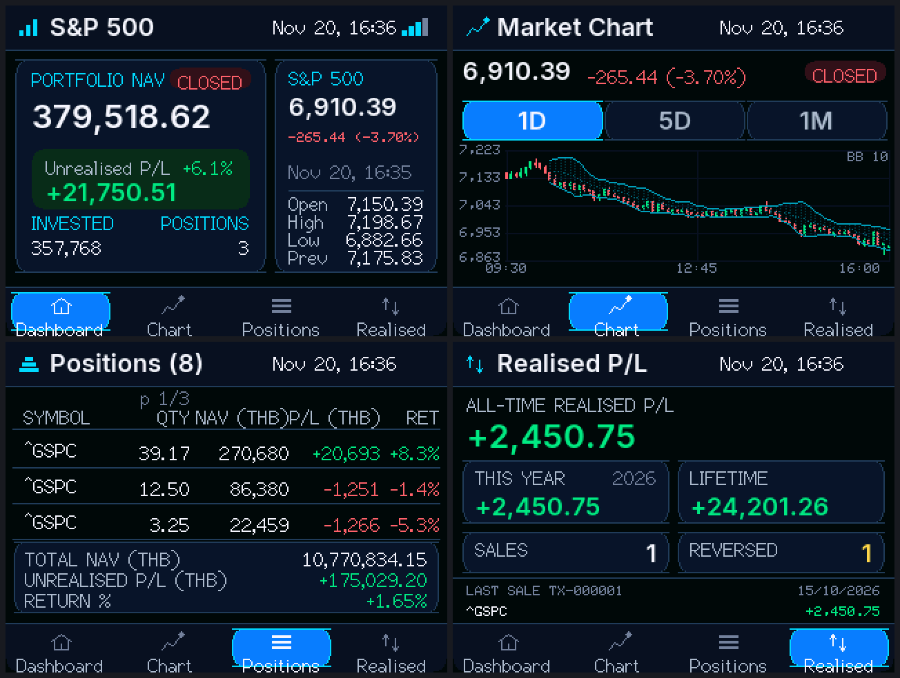
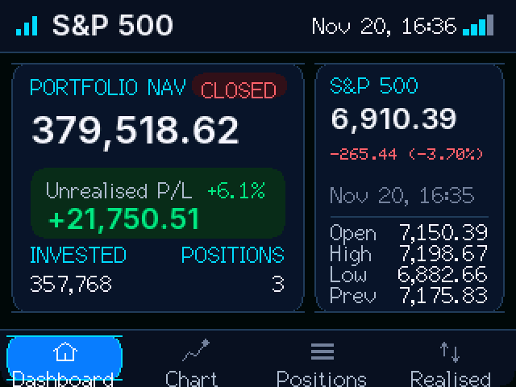
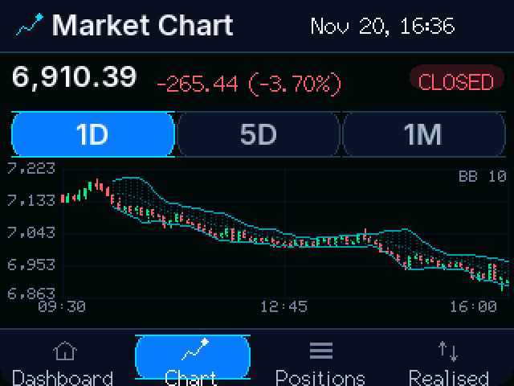
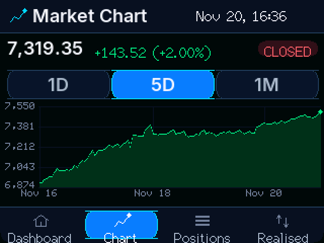
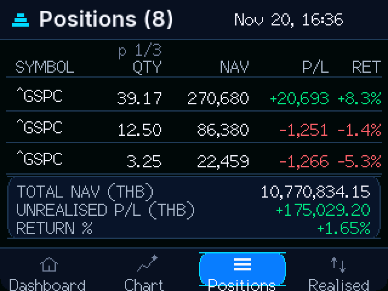
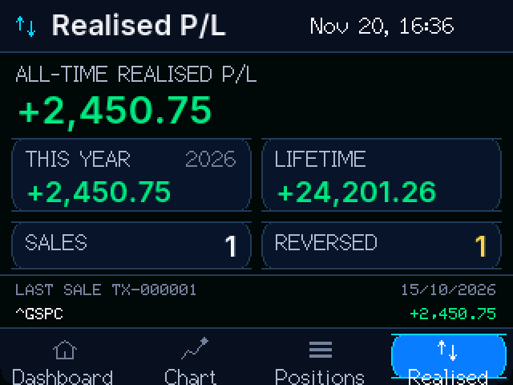
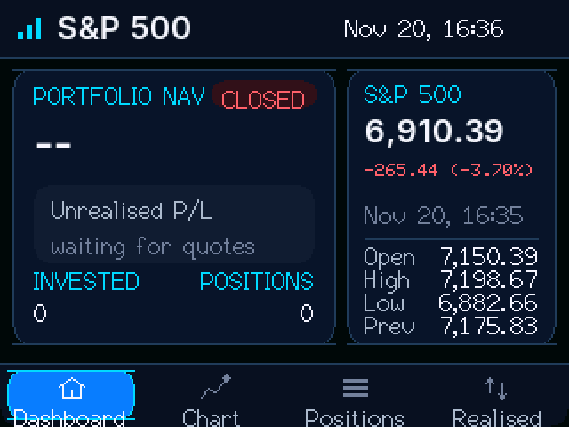

# S&P 500 Portfolio Monitor for the ESP32 "Cheap Yellow Display"

A 320x240 touch-screen **S&P 500 / portfolio tracker** you can keep on a desk. Four
pages you swipe between with your finger, plus a full web dashboard served by the same
device. Quotes and charts come from Yahoo Finance; positions and the sale ledger live in
the display's own flash. No cloud account, no server, no subscription.

This is the ESP32 / TFT_eSPI port of [SP500_SmallTV](https://github.com/komkritc/S-P-500-Portfolio-Monitor-SmallTV-ESP8266-) (ESP8266,
240x240, no touch). The firmware core is shared: same position model, same sale ledger,
same JSON API, same web UI. What differs is the screen - bigger, landscape, and with
**touch navigation** instead of a rotation timer only.

<p align="center"></p>

*The four pages, in nav order: Dashboard, Market Chart, Positions, Realised P/L. These are
the firmware's real drawing code run on a PC against a mock `TFT_eSPI` with sample data
(`tests/preview/`) - no camera photo, no real holdings, nothing staged.*

## Screenshots

| Dashboard (portfolio + ^GSPC card) | Market chart 1D, down day (BB + candles) |
|---|---|
|  |  |

| Market chart 5D, up day (BB + candles) | Positions (8 lots, 1 of 3 pages) |
|---|---|
|  |  |

| Realised P/L | First boot, no positions yet |
|---|---|
|  |  |

The plot is drawn green or red by the sign of the range's change, so 1D is measured against
the previous close and 5D / 1M against their own first bar. Both chart images above have the
**BB + candles** switch on (web Settings tab): bodies and wicks come from the stored open /
high / low, each bar coloured by its own close against its own open, with Bollinger Bands
(SMA + 2 sigma) over them and the period actually used printed in the corner - `BB 10` on the
79-bar 1D, `BB 20` on the 112-bar 5D. With the switch off the same page is the plain
single-colour line and fill. Offline and no-data states are
drawn too (`docs/img/lcd-offline.png`), as is the boot banner.

## Features

* **Touch navigation.** A 4-zone nav bar (Dashboard | Chart | Positions | Realised), 1D / 5D
  / 1M buttons right on the chart, and page scrolling on the Positions page. Auto-rotation
  still runs in the background, and a `pages` checkbox mask decides which screens it visits.
* **Dimmable panel.** **LCD brightness (%)** on the web Settings tab dims the backlight the
  moment you let go of the slider (5 kHz PWM, 5 % floor so the screen can never go dark for
  good); the level is kept in flash and survives reboots and OTA updates.
* **Technical chart on glass.** One Settings switch (**BB + candles on the LCD chart**) turns the
  panel's Market page into a **candlestick** chart with **Bollinger Bands** (SMA 10 / 20 / 50, fixed
  2 sigma): bodies and wicks come from the stored open / high / low, the bands from the closes, so the
  panel and the web chart tell the same story. The period is clamped to half the bars the panel keeps
  (1M stores 24 daily bars) and the plot prints the period it actually used; with the switch off the
  chart is the plain line and fill it always was.
* **Portfolio on glass:** NAV, unrealised P/L in THB and %, invested capital in whole baht,
  position count, a live `^GSPC` card with open / high / low / prev, and a separate Realised
  P/L page (all-time, this year, lifetime, sales, reversals, last sale).
* **Web dashboard** at `http://sp500-32.local`: portfolio cards, interactive 1D / 5D / 1M
  chart drawn as real **candlesticks** (open / high / low / close per bar) with an optional
  **Bollinger Bands** overlay — period 10 / 20 / 50 and 1.5 / 2 / 2.5σ width, remembered per
  browser, computed in the page from the same series so the device stores nothing extra,
  sortable position table, add and delete positions, sell with preview and confirm,
  transaction history with undo and delete, CSV export, Wi-Fi setup, settings, diagnostics
  and OTA upload. Dark theme, works on a phone.
* **Sale ledger:** FIFO or a specific lot (oldest purchase date first), THB amount / quantity /
  entire holding, preview before anything is written, undo as a reversal record (booked to the
  original sale's year, so "this year" figures stay comparable), permanent delete, power-loss
  recovery through a journal file. Append-only.
* **Honest numbers:** unknown data is `N/A`, never `0`; a failed refresh keeps the last value
  and marks it STALE; market status follows the NYSE calendar and real New York DST.

## How it works

```
Yahoo Finance (TLS) -> MarketData (scheduler, backoff) -> AppState (raw inputs)
                                                             |
                             FinancialCalculator (the only place money is computed)
                                                             |
                     derived outputs: summary / per-position results / quote / chart stats
                           |                                            |
              DisplayUI (TFT_eSPI, touch = TouchUI)          Web API + embedded dashboard
```

## What has actually been run on this device

| Area | State |
|---|---|
| Build, USB flash, boot (CH340, `/dev/ttyUSB0`) | **verified on the CYD** |
| OTA over Wi-Fi (`espota`, `sp500-32.local`) | **verified on the CYD**, repeated |
| Wi-Fi join, mDNS, NTP | **verified on the CYD** (`sp500-32.local`, rssi ~ -51) |
| Live `^GSPC` quote, 1D / 5D / 1M charts, TLS | **verified on the CYD** |
| Portfolio maths on device | **verified**: LCD and `/api/portfolio` agree (invested 10,600,000 / NAV 11,005,643.93 / 3 positions) |
| LCD layout | host-rendered (71 frames, 0 overlap or overflow) **and** looked at on the real panel; several spacing bugs were found that way and fixed |
| Web dashboard against the live device | portfolio, settings (time zone), positions |
| Host unit tests | 866 checks pass (738 core + 128 sale engine) |
| Touch navigation on the real panel | implemented; nav zones and period buttons used during layout work, not separately regression-tested |
| Sale ledger on the CYD hardware | host-tested only (this device has 0 sale records) |
| Rescue AP, captive portal, long-run soak | not exercised on this device |

## Hardware

ESP32 "Cheap Yellow Display" (ESP32-2432S028R): ESP32 dual-core 240 MHz, 4 MB flash,
ILI9341 320x240 SPI panel + XPT2046 resistive touch, CH340 USB-serial.

| | |
|---|---|
| Panel | ILI9341 (driver `ILI9341_2`), MISO 12, MOSI 13, SCLK 14, CS 15, DC 2, BL 21, no RST line (`TFT_RST=-1`), SPI 55 MHz |
| Touch | XPT2046 on its own VSPI bus, CS 33, IRQ 36, 2.5 MHz |
| USB | CH340 at **115200** (921600 drops the sync on this board) |
| Partitions | `partitions.csv`: two app slots of 0x190000 (1,638,400 B) + 832 KB LittleFS (label `spiffs`, which is what core 2.0.17's LittleFS looks up), ending exactly at 0x400000 |
| Limits | 12 open lots, 8 distinct quoted symbols, 2000 ledger records (warn from 1800) |

## Build and flash

PlatformIO (tested 6.2.0, `espressif32`, Arduino core 2.0.17). Libraries: `bodmer/TFT_eSPI`,
`bblanchon/ArduinoJson`, `XPT2046_Touchscreen` v1.4 - fetched automatically.

```bash
cd ESP32-CYD-SP500
cp include/secrets.example.h include/secrets.h   # then fill in WIFI_SSID / WIFI_PASS / OTA_PASS
pio run -e cyd                                    # build (USB build)
pio run -e cyd -t upload --upload-port /dev/ttyUSB0        # USB flash
pio run -e cyd_ota -t upload --upload-port sp500-32.local  # OTA flash over Wi-Fi
```

`include/secrets.h` is git-ignored because it holds your Wi-Fi credentials; the firmware
boots with it blank and stays offline until Wi-Fi is supplied by the portal instead.
`TZ_OFFSET_SEC` in that file is only the boot default - the display zone is a setting
(`tzMode` + `localOffsetMin`, and the web UI has a **Bangkok (ICT, UTC+7)** preset).

> **Careful on this LAN:** `sp500.local` is the ESP8266 SmallTV. This firmware must go to
> `sp500-32.local`. The wrong target would brick the other gadget's app slot.

## First connection

* With credentials in `include/secrets.h` it just joins on boot and announces mDNS -
  the dashboard is at `http://sp500-32.local` (host name is a setting).
* Without them it opens an open AP **`sp500-setup-XXXXXX`** with a DNS captive portal; the
  SSID and IP are printed on the serial console (115200) - the LCD only shows a yellow
  Wi-Fi icon. Then pick your 2.4 GHz network on the Wi-Fi tab.
* If a saved network is unreachable for 3 minutes it raises a **WPA2 rescue AP** whose random
  key is printed on the serial console; the admin password is waived while that AP is up.

## Using the touch screen

* **Nav bar** (bottom, four zones): Dashboard, Chart, Positions, Realised. The nav zone id
  equals the screen id; the `pages` bitmask keeps its historical numbering, so an old
  `config.json` still means the same pages. A tap on the strip just above the nav bar (where
  the page dots used to be) selects the zone under it.
* **Swipe** left/right anywhere on the content area steps to the next / previous screen.
* **Chart page:** tap `1D` / `5D` / `1M`. While the rotation is running, entering the chart
  page steps to the next enabled range (`charts` mask).
* **Positions:** 3 rows per page, scroll with a vertical swipe (finger up = next page);
  totals at the bottom. A vertical swipe is only a scroll on the Positions page.
* Touching anything cancels the auto-rotation timer, and a screen switched off by the mask
  can always be opened by hand - the masks can never lock you out.

## Web dashboard

Portfolio / Market / Details / Sales / Wi-Fi / Settings / System tabs. Add a position by
symbol + date + THB amount (the device looks up that day's close, never a later bar) or by
quantity and price. Dates in the UI are `dd/mm/yyyy`; the API speaks ISO.
Settings: refresh intervals, page-rotate seconds, LCD page and chart-range masks, default
range, time zone, LCD brightness, hostname, admin password.

## API

See [docs/API.md](docs/API.md). `GET /api/status|portfolio|positions|market|chart|realised|sales|settings|wifi/*`,
`POST /api/settings|positions|positions/delete|refresh|cache/clear|sales/preview|sales/confirm|sales/reverse|sales/delete|wifi/*|system/*`,
plus `POST /update` and ArduinoOTA on 3232 (password = admin password). If an admin password
is set, every `POST`, `/update` and every sale endpoint need HTTP Basic auth.

## Memory and flash (measured)

| | |
|---|---|
| Flash image | `firmware.bin` 1,241,840 B; PlatformIO reports **75.4 % (1,235,261 B of the 1,638,400 B app slot)** |
| Static RAM | **19.6 % (64,136 B of 327,680 B)** |
| Free heap at idle, from `/api/status` on the device | ~209-213 KB, largest block ~110 KB, fragmentation ~48 % |
| LittleFS after setup | 12,288 B used of 811,008 B |

There is room to spare, unlike the ESP8266 build. Note that TLS certificate validation is
**off** (`setInsecure`): on an untrusted LAN an attacker could feed false quotes.

## Tests

```bash
python3 tests/run_tests.py             # 866 host checks (738 core, 128 sale engine)
python3 tests/preview/run_preview.py   # renders every page x 11 scenarios to PNG + layout checks
python3 tools/make_readme_img.py       # rebuilds the screenshots in docs/img from that output
python3 tools/gen_web_assets.py        # regenerates web/web_assets.h after editing web/index.html
```

The preview harness compiles `DisplayUI.cpp` against a mock `TFT_eSPI` that rasterises to a
real 320x240 framebuffer, records every text ink box, and fails a frame when two texts
overlap or anything leaves the screen - so a spacing bug is a build failure, not something
you only notice on the display. `DUMPBOXES=1 ./tests/preview/preview tests` prints the ink
boxes used to tune the layout. Screens in the README are 2x nearest-neighbour, never smoothed.

## Project layout

```
sp500cyd.ino        setup()/loop(): wiring only
src/DisplayUI.*     all LCD drawing (statics + cached dynamic pass), fonts, ink metrics
src/TouchUI.*       XPT2046 read, hit zones (nav bar, period buttons, page strip)
src/core/           AppTypes, AppState, MarketClock (NY time / NYSE), Format, JsonWriter, FlatJson
src/finance/        FinancialCalculator, Portfolio, SaleEngine, ChartData, YahooParser, YahooFinance, MarketData
src/config/         AppConfig (limits and validation of the settings patch)
src/storage/        StorageManager (atomic writes, cache), SaleStore (append-only ledger + journal + delete)
src/network/        WiFiManager (AP / captive portal / rescue), WebServerManager, OTAManager
include/config.h    screen geometry: header, nav zones, card and row positions
web/                index.html (source), web_assets.h (generated, gzipped)
tests/ tools/ docs/
```

## Notes and limits

* 2.4 GHz Wi-Fi only (ESP32 on this board), HTTP Basic over plain HTTP - LAN use only.
* Yahoo's unofficial endpoint may rate-limit; the device backs off (up to 10 min) and shows
  stale data instead of failing.
* The two READMEs share the data rules (N/A never 0, STALE handling, unrealised vs realised
  vs lifetime P/L, `N/A` semantics for unknown sides) - the full text is in
  [the SmallTV README](https://github.com/komkritc/S-P-500-Portfolio-Monitor-SmallTV-ESP8266-) and [docs/API.md](docs/API.md).
* There is no automatic boot-slot rollback: an upload goes to the free app slot, so a broken
  image is recovered by re-flashing (USB always works).
